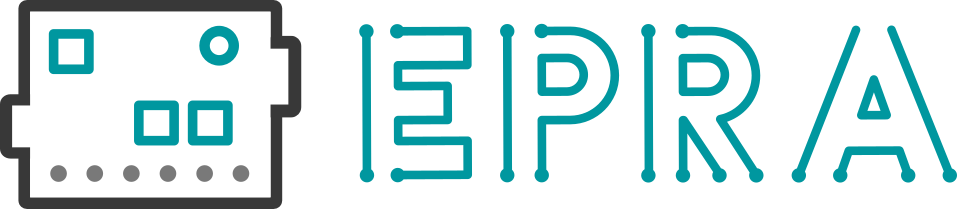

# 🌌 Portal EPRA — Engenharia de Projetos e Robótica Aplicada

<div align="center">
  
  <p><em>Plataforma unificada de governança, educação e exibição de impacto social do EPRA - UFC Russas.</em></p>

  [](https://nextjs.org/)
  [](https://react.dev/)
  [](https://tailwindcss.com/)
  [](https://www.prisma.io/)
  [](https://opensource.org/licenses/MIT)
</div>

---

## 📖 Sobre o Projeto

O **EPRA Portal** é a central digital da Engenharia de Projetos e Robótica Aplicada (EPRA) da UFC Campus Russas. Desenvolvido para consolidar a presença institucional, gerenciar membros e facilitar o aprendizado de robótica e Arduino na comunidade acadêmica.

A plataforma serve como um hub para:
- 🛠️ **Tutoriais e Desafios**: Conteúdo estruturado para aprendizado de hardware e software.
- 📂 **Portfólio de Projetos**: Exibição de projetos de impacto desenvolvidos pelos membros.
- 🎓 **Gestão de Cursos**: Inscrições e acompanhamento de capacitações oferecidas.
- 🏛️ **Governança**: Painéis administrativos para gestão de membros e transparência de métricas de impacto.

---

## 🎨 Estética e Design

O portal adota uma identidade visual **Cyberpunk Industrial**, focada em:
- **Glassmorphism**: Interfaces translúcidas com efeitos de desfoque de fundo.
- **HUD Elements**: Micro-animações e componentes inspirados em interfaces de alta tecnologia.
- **Tipografia Técnica**: Uso da fonte `Space Grotesk` para um visual limpo e denso.
- **Design Tokens**: Sistema rígido de cores e espaçamentos gerenciado via Tailwind CSS v4.

---

## 🚀 Stack Tecnológica

### Frontend
- **Framework**: [Next.js 15+](https://nextjs.org/) (App Router)
- **UI**: [React 19](https://react.dev/) + [Framer Motion](https://www.framer.com/motion/) (Animações)
- **Styling**: [Tailwind CSS v4](https://tailwindcss.com/)
- **Icons**: [Lucide React](https://lucide.dev/)

### Backend & Banco de Dados
- **Runtime**: Node.js
- **ORM**: [Prisma](https://www.prisma.io/)
- **Database**: PostgreSQL (Hospedado no [Neon](https://neon.tech/))
- **Auth**: JWT-based session management com RBAC.

### Infraestrutura
- **Deploy**: [Vercel](https://vercel.com/)
- **Containerization**: Docker (Para servidores institucionais)

---

## 🗺️ Roadmap de Desenvolvimento

O projeto está sendo desenvolvido em **9 fases estratégicas**:

| Fase | Status | Descrição |
| :--- | :---: | :--- |
| **1. Backend Core** | ✅ | Migração de mocks para PostgreSQL + Prisma + JWT. |
| **2. Gestão de Cursos** | ✅ | CRUD de cursos e sistema de matrículas com controle de vagas. |
| **3. Sistema de Desafios** | ✅ | Submissão de soluções via GitHub e exportação de participantes. |
| **4. Depoimentos & Comunidade** | ✅ | Histórias de sucesso e métricas de impacto social. |
| **5. Permissões & Admin** | ✅ | Gestão de papéis (Orientador/Membro) e auditoria. |
| **6. Gestão de Vagas** | ✅ | Sistema de recrutamento interno com anexo de currículos. |
| **7. Biblioteca & Material** | ✅ | Repositório de códigos, bibliotecas e materiais didáticos. |
| **8. Gerenciador de Portfólio** | 🚧 | Exibição detalhada de projetos e links de repositórios. |
| **9. Deployment & Vercel** | 📅 | Automação de CI/CD e otimização em Edge Network. |

---

## 🛠️ Configuração e Instalação

### Pré-requisitos
- Node.js 20+
- Instância de PostgreSQL (ou use o Neon)

### Passo a Passo

1.  **Clonar o repositório:**
    ```bash
    git clone https://github.com/seu-usuario/epra-portal.git
    cd epra-portal
    ```

2.  **Instalar dependências:**
    ```bash
    npm install
    ```

3.  **Configurar variáveis de ambiente:**
    Crie um arquivo `.env.local` na raiz e adicione as chaves conforme o `.env.example`:
    ```env
    DATABASE_URL="postgresql://..."
    JWT_SECRET="sua-chave-secreta"
    AUTH_V2="true"
    ```

4.  **Sincronizar banco de dados:**
    ```bash
    npx prisma migrate dev
    npx prisma db seed
    ```

5.  **Rodar servidor de desenvolvimento:**
    ```bash
    npm run dev
    ```

Acesse `http://localhost:3000` para visualizar o portal.

---

## 🔐 Níveis de Acesso (RBAC)

- **EXTERNO**: Visualização de landing page, portfólio e formulários públicos.
- **ALUNO INTERNO**: Acesso ao console de conteúdo, submissão de materiais e perfil.
- **ORIENTADOR**: Controle total do sistema, gestão de membros e métricas de impacto.

---

## 📄 Licença

Este projeto está sob a licença MIT. Veja o arquivo [LICENSE](LICENSE) para detalhes.

---

<div align="center">
  Desenvolvido com 💙 pela equipe <strong>EPRA - UFC Russas</strong>.
</div>
