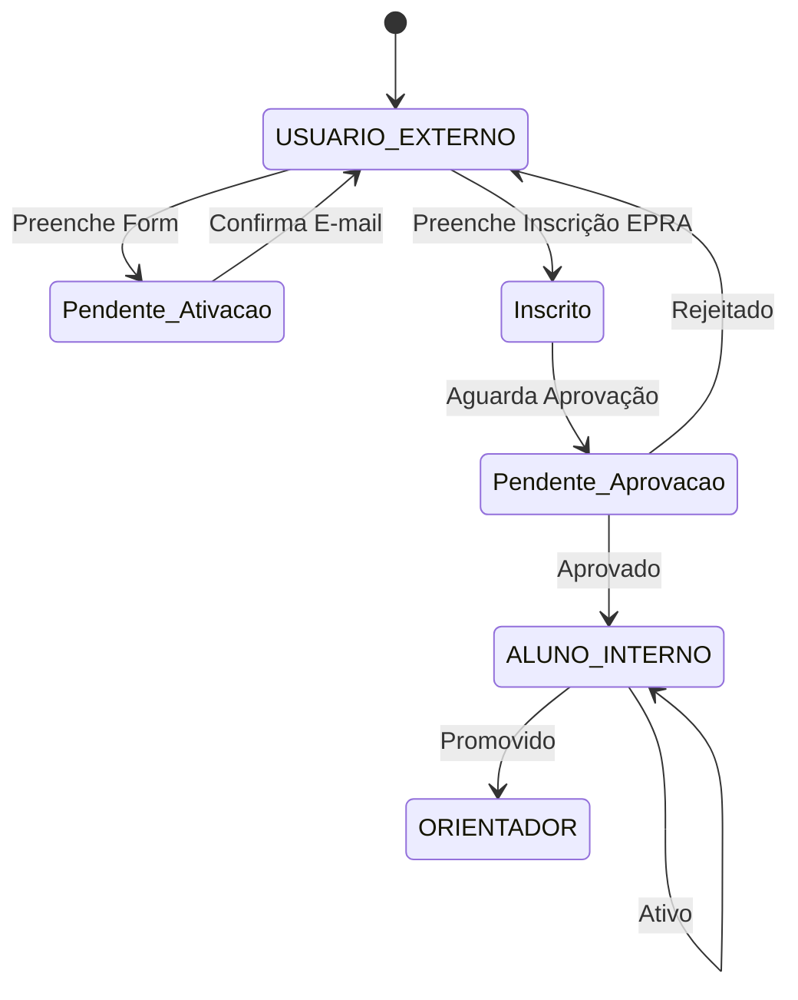

# UX.md - Experiência do Usuário

## 1. Visão Geral

Este documento mapeia a **jornada do usuário** e os **fluxos de interação** do EPRA Portal v5.0, focando nas personas definidas (Orientador, Membro, Externo) e nos fluxos de conteúdo.

### Objetivos UX

| Objetivo | Descrição |
|----------|-----------|
| **Clareza** | Interface técnica mas acessível |
| **Eficiência** | 3 cliques para qualquer ação |
| **Consistência** | Padrão visual Neon Pulse em toda aplicação |

---

## 2. As 10 Seções da Landing Page

### 2.1 Mapeamento Completo

| # | ID Section | Arquivo | Propósito |
|---|------------|---------|-----------|
| 1 | `header` | `Header.tsx` | Navegação + Auth |
| 2 | `hero` | `Hero.tsx` | Terminal principal + CTA |
| 3 | `metrics` | `Metrics.tsx` | Dashboard de impacto |
| 4 | `mission` | `MissionLog.tsx` | História UFC Russas |
| 5 | `modules` | `ModuleGrid.tsx` | Nodes de aprendizado |
| 6 | `challenge` | `Challenge.tsx` | Protocolo de Alarme |
| 7 | `testimonials` | `Testimonials.tsx` | Feedback usuários |
| 8 | `courses` | `Courses.tsx` | Protocolos Ativos |
| 9 | `portfolio` | `Portfolio.tsx` | Showcase Hardware |
| 10 | `recruitment` | `Recruitment.tsx` | Alistamento + Footer |

### 2.2 Wireframe das Seções

```
┌─────────────────────────────────────────────────┐
│ [1] HEADER                                      │
│ ─────────────────────────────────────────────── │
│ logo | INICIO | SOBRE | DESAFIOS | TUTORIAL |   │
│ CURSOS | [LOGIN/ACESSAR]                        │
└─────────────────────────────────────────────────┘
┌─────────────────────────────────────────────────┐
│ [2] HERO                                        │
│ ─────────────────────────────────────────────── │
│ ┌─────────────────────────────────────────────┐ │
│ │ STATUS: System_Online // Protocol_EPRA       │ │
│ │                                             │ │
│ │ DECODE O FUTURO COM                         │ │
│ │ ████████ ROBÓTICA ████████                  │ │
│ │                                             │ │
│ │ Domine Arduino, C++ e Python...             │ │
│ │                                             │ │
│ │ [VER CURSOS]    [EXPLORAR TUTORIAIS]        │ │
│ └─────────────────────────────────────────────┘ │
└─────────────────────────────────────────────────┘
┌─────────────────────────────────────────────────┐
│ [3] METRICS                                    │
│ ─────────────────────────────────────────────── │
│ ┌────────┐ ┌────────┐ ┌────────┐ ┌────────┐   │
│ │MOD_01  │ │MOD_02  │ │MOD_03  │ │MOD_04  │   │
│ │847     │ │23      │ │3.240   │ │156     │   │
│ │ALUNOS  │ │ESCOLAS │ │LAB_HRS │ │PROJECTS│   │
│ │[████░░]│ │[███░░░]│ │[██████]│ │[████░░]│   │
│ └────────┘ └────────┘ └────────┘ └────────┘   │
└─────────────────────────────────────────────────┘
┌─────────────────────────────────────────────────┐
│ [4] MISSION LOG                                │
│ ─────────────────────────────────────────────── │
│ ┌──────────────────┐ ┌──────────────────────┐   │
│ │TERMINAL          │ │                      │   │
│ │ROOT@EPRA:~$      │ │ MISSION_LOG          │   │
│ │> carregando...   │ │ :: UFC_RUSSAS        │   │
│ │> processando...  │ │                      │   │
│ │> sucesso!        │ │ Nascido no Campus... │   │
│ └──────────────────┘ └──────────────────────┘   │
└─────────────────────────────────────────────────┘
┌─────────────────────────────────────────────────┐
│ [5] MODULE GRID                                │
│ ─────────────────────────────────────────────── │
│ ┌─────────────────────────────────────────────┐ │
│ │ EDUCATIONAL_DIRECTORY // CORE_MODULES       │ │
│ │ ┌─────┐ ┌─────┐ ┌─────┐ ┌─────┐ ┌─────┐   │ │
│ │ │Arduino│ │C++  │ │Python│ │ROS  │ │ESP32│   │ │
│ │ └─────┘ └─────┘ └─────┘ └─────┘ └─────┘   │ │
│ └─────────────────────────────────────────────┘ │
└─────────────────────────────────────────────────┘
┌─────────────────────────────────────────────────┐
│ [6] CHALLENGE                                  │
│ ──���──────────────────────────────────────────── │
│ ┌─────────────────────────────────────────────┐ │
│ │ [PROTOCOL_ALARM] ⚠️                         │ │
│ │                                             │ │
│ │ ALGORITMO // COMPETIÇÃO // INOVAÇÃO         │ │
│ │                                             │ │
│ │ Desafios de robótica com deadline           │ │
│ │ [PARTICIPAR]                                │ │
│ └─────────────────────────────────────────────┘ │
└─────────────────────────────────────────────────┘
┌─────────────────────────────────────────────────┐
│ [7] TESTIMONIALS                               │
│ ─────────────────────────────────────────────── │
│ ┌─────────────────────────────────────────────┐ │
│ │ FEEDBACK // DOS // TERMINAIS               │ │
│ │ ┌───────────┐ ┌───────────┐ ┌───────────┐  │ │
│ │ │ ★★★★★    │ │ ★★★★★    │ │ ★★★★★    │  │ │
│ │ │Depoimento │ │Depoimento │ │Depoimento │  │ │
│ │ │Aluno A    │ │Aluno B    │ │Aluno C    │  │ │
│ │ └───────────┘ └───────────┘ └───────────┘  │ │
│ └─────────────────────────────────────────────┘ │
└─────────────────────────────────────────────────┘
┌────────────────────���────────────────────────────┐
│ [8] COURSES                                    │
│ ─────────────────────────────────────────────── │
│ ┌─────────────────────────────────────────────┐ │
│ │ PROTOCOLOS ATIVOS // VER_3.0                │ │
│ │ ┌─────────────┐ ┌─────────────┐             │ │
│ │ │ Curso 1    │ │ Curso 2    │             │ │
│ │ │ [DETALHES] │ │ [DETALHES] │             │ │
│ │ └─────────────┘ └─────────────┘             │ │
│ └─────────────────────────────────────────────┘ │
└─────────────────────────────────────────────────┘
┌───────���─────────────────────────────────────────┐
│ [9] PORTFOLIO                                 │
│ ─────────────────────────────────────────────── │
│ ┌─────────────────────────────────────────────┐ │
│ │ SHOWCASE // HARDWARE                        │ │
│ │ [img robot] [img circuit] [img project]     │ │
│ └─────────────────────────────────────────────┘ │
└─────────────────────────────────────────────────┘
┌─────────────────────────────────────────────────┐
│ [10] RECRUITMENT + FOOTER                      │
│ ─────────────────────────────���───────────────── │
│ ┌─────────────────────────────────────────────┐ │
│ │ JUNTE-SE AO EPRA                            │ │
│ │ [FORMULARIO DE INSCRIÇÃO]                   │ │
│ └─────────────────────────────────────────────┘
│ UFC Russas | GitHub | Contato | © 2026         │
└─────────────────────────────────────────────────┘
```

---

## 3. Jornadas de Usuário

### 3.1 Jornada de Onboarding (UC1 - Cadastro e Ativação)

```
┌─────────────────────────────────────────────────┐
│ PASSO 1: Landing Page                          │
│ - Clique em [LOGIN/ACESSAR]                    │
└────────────────────┬────────────────────────────┘
                     │
                     ▼
┌─────────────────────────────────────────────────┐
│ PASSO 2: Tela de Login / Cadastro               │
│ - Clique em "Ainda não tem conta? Cadastre-se" │
│ - Preenchimento: Nome, Email, Senha, Curso     │
│ - Clique em [CADASTRAR]                        │
└────────────────────┬────────────────────────────┘
                     │
                     ▼
┌─────────────────────────────────────────────────┐
│ PASSO 3: Confirmação de Cadastro                │
│ - Sistema registra conta (isEmailConfirmed: f)  │
│ - Feedback: "E-mail de ativação enviado"       │
└────────────────────┬────────────────────────────┘
                     │
                     ▼
┌─────────────────────────────────────────────────┐
│ PASSO 4: Ativação via E-mail                    │
│ - Usuário clica no link mágico                  │
│ - Rota /api/auth/activate valida token          │
│ - Conta ativada (isEmailConfirmed: true)        │
└────────────────────┬────────────────────────────┘
                     │
                     ▼
┌─────────────────────────────────────────────────┐
│ PASSO 5: Controle de Acesso (Orientador)        │
│ - Nova conta aparece no Access Control          │
│ - Notificação visual para o Orientador          │
└─────────────────────────────────────────────────┘
```

### 3.2 Jornada de Inscrição (Externo → Membro)

### 3.1 Fluxo Completo

```
┌─────────┐
│ VISITANTE│
│ Externo  │
└────┬────┘
     │
     ▼
┌─────────────────────────────────────────────────┐
│ PASSO 1: Landing Page                          │
│                                                 │
│ - Navega pelas seções                           │
│ - Vê métricas e depoimentos                    │
│ - Interage com Hero CTA [VER CURSOS]           │
└────────────────────┬────────────────────────────┘
                     │
                     ▼
┌─────────────────────────────────────────────────┐
│ PASSO 2: Explora Cursos                        │
│                                                 │
│ - Scroll para seção [courses]                  │
│ - Visualiza cursos disponíveis                  │
│ - Clica em [DETALHES]                          │
└────────────────────┬────────────────────────────┘
                     │
                     ▼
┌─────────────────────────────────────────────────┐
│ PASSO 3: Formulário de Inscrição               │
│                                                 │
│ - Clica em [QUERO ME INSCREVER]                 │
│ - Preenche formulário                          │
│ - Nome, Email, Escola, Interesse               │
└────────────────────┬────────────────────────────┘
                     │
                     ▼
┌─────────────────────────────────────────────────┐
│ PASSO 4: Confirmação                            │
│                                                 │
│ - Mensagem de sucesso                          │
│ - "Aguarde aprovação do orientador"            │
│ - Redirect para Landing Page                   │
└────────────────────┬────────────────────────────┘
                     │
                     ▼
┌─────────────────────────────────────────────────┐
│ PASSO 5: Aprovação (Assíncrono)                │
│                                                 │
│ - Orientador revisa inscrições                 │
│ - Membro envia notificação de aprovação        │
│ - Externo recebe email (futuro)                 │
└────────────────────┬────────────────────────────┘
                     │
                     ▼
┌─────────┐
│ MEMBRO  │
│ Ativo   │
└─────────┘
```

### 3.2 Diagrama de Estados do Usuário



---

## 4. Fluxo de Moderação de Conteúdo

### 4.1 Fluxo Completo

```
┌─────────────────────────────────────────────────┐
│ CONTENT MANAGER (ALUNO_INTERNO ou ORIENTADOR)   │
└────────────────────┬────────────────────────────┘
                     │
                     ▼
┌─────────────────────────────────────────────────┐
│ TABS DE CONTEÚDO                                │
│                                                 │
│ [Cursos] [Desafios] [Tutoriais] [Depoimentos] │
└────────────────────┬────────────────────────────┘
                     │
         ┌───────────┴───────────┐
         │                       │
         ▼                       ▼
┌─────────────────┐   ┌─────────────────────────┐
│ CRUDConteúdo    │   │ MODERAÇÃO Depoimentos   │
│ (Cursos/        │   │                         │
│  Desafios/      │   │ Fluxo específico:       │
│  Tutoriais)     │   │ 1. Ver depoimentos      │
│                 │   │ 2. Aprovar/Rejeitar      │
│                 │   │ 3. Publicar no site     │
└─────────────────┘   └─────────────────────────┘
         │                       │
         └───────────┬───────────┘
                     │
                     ▼
┌─────────────────────────────────────────────────┐
│ PUSH PARA PRODUÇÃO                              │
│                                                 │
│ [PUSH] → Atualiza content.json                 │
│ Status: IDLE → PUSHING → SUCCESS               │
└─────────────────────────────────────────────────┘
```

### 4.2 Tabela de Ações

| Tipo | Visualizar | Criar | Editar | Deletar | Publicar |
|------|-----------|-------|--------|---------|----------|
| **Curso** | ALUNO_INTERNO+ | ALUNO_INTERNO+ | ALUNO_INTERNO+ | ORIENTADOR | ORIENTADOR |
| **Desafio** | ALUNO_INTERNO+ | ALUNO_INTERNO+ | ALUNO_INTERNO+ | ORIENTADOR | ORIENTADOR |
| **Tutorial** | ALUNO_INTERNO+ | ALUNO_INTERNO+ | ALUNO_INTERNO+ | ORIENTADOR | ORIENTADOR |
| **Depoimento** | ALUNO_INTERNO+ | USUARIO_EXTERNO | - | ORIENTADOR | ORIENTADOR |

---

## 5. Fluxo de Autenticação (RBAC)

### 5.1 Login Flow

```
┌─────────────────────────────────────────────────┐
│ PÁGINA DE LOGIN                                 │
│                                                 │
│ [Selecionar Role Mockado]                       │
│                                                 │
│ ○ USUARIO_EXTERNO (Visitante)                  │
│ ○ ALUNO_INTERNO (Aluno)                        │
│ ● ORIENTADOR (Professor) ← Default para demo    │
│                                                 │
│ [ENTRAR NO SISTEMA]                            │
└────────────────────┬────────────────────────────┘
                     │
                     ▼
┌─────────────────────────────────────────────────┐
│ REDIRECT BASEADO NO ROLE                        │
│                                                 │
│ USUARIO_EXTERNO → /dashboard/profile            │
│ ALUNO_INTERNO   → /dashboard/content            │
│ ORIENTADOR      → /dashboard/admin              │
└─────────────────────────────────────────────────┘
```

### 5.2 Permissões de Rotas

| Rota | USUARIO_EXTERNO | ALUNO_INTERNO | ORIENTADOR |
|------|---------|--------|------------|
| `/` | ✅ | ✅ | ✅ |
| `/login` | ✅ | ✅ | ✅ |
| `/dashboard/profile` | ✅ | ✅ | ✅ |
| `/dashboard/content` | ❌ | ✅ | ✅ |
| `/dashboard/admin` | ❌ | ❌ | ✅ |

---

## 6. Regras de Ouro para IA

> **ATENÇÃO: Regras que a IA NUNCA deve violar ao editar este documento**

1. **10 seções** - Documentar TODAS, não omitir nenhuma
2. **Hero CTA** - Links para `#courses` (não URLs externas)
3. **3 cliques** - Qualquer ação deve ser acessível em 3 cliques
4. **Mobile-first** - Layout responsivo para todas as seções
5. **Smooth scroll** - Navegação suave via `useSmoothScroll`
6. **RBAC respeitado** - Fluxos bloqueados se role não permitido
7. **Formulário** - Redireciona para Landing Page (não tem BD ainda)
8. **Sem Inventar** - Usar IDs/nomes reais do `content.json`

---

## 7. Referências

- [PRODUCT.md](./PRODUCT.md) - Personas
- [ARCHITECTURE.md](./ARCHITECTURE.md) - RBAC
- [DESIGN_SYSTEM.md](./DESIGN_SYSTEM.md) - Estilos
- `src/components/sections/*.tsx` - Implementação das seções
- `src/hooks/useSmoothScroll.ts` - Navegação suave
- `src/data/content.json` - Dados das seções